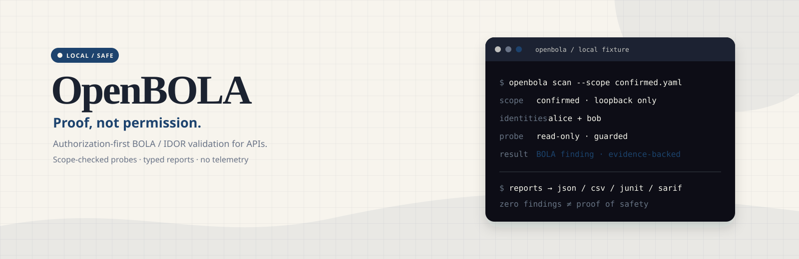

[](#status)
[](#limitations)
[](#install-for-development)
[](LICENSE)

# OpenBOLA

Authorization-first, deterministic BOLA/IDOR validation for HTTP APIs.

OpenBOLA is an open-source, local-first application for teams with written
permission to assess an API. It correlates traffic from multiple identities,
records only evidence-backed ownership, and compares an owner's request with
an attacker's request for the same object. The target-probe network boundary
belongs to the deterministic executor; separately scoped browser capture can
collect structural traffic. AI may suggest a typed plan from sanitized
evidence, but it has no target-network access and cannot widen policy.

> **Local v1 materials:** the visual launch surface, demo transcript, packaging
> contracts, and approval-gated GitHub checklist are checked in. The repository
> rename, release, and other external launch actions are still pending separate
> approval. Test only systems you own or systems covered by explicit, written
> authorization.

## Why OpenBOLA?

Many authorization tests stop at “the endpoint returned 200”. OpenBOLA keeps
the decision auditable:

- ownership is persisted only when the captured evidence is explicit or an
  unambiguous create/response correlation;
- every request, including every redirect hop, must receive a fresh
  `ScopeDecision`;
- read probes are the default, while writes require a separate method/path
  grant and a reversible canary plus cleanup request;
- replay credentials supplied through environment references stay in an
  in-memory vault and are excluded from SQLite, reports, and MCP responses;
  HAR output follows the structural redaction boundary documented below and
  is not a general-purpose secret detector;
- each attempted owner/object/attacker combination is recorded in append-only
  state and reports distinguish untested, inconclusive, protected, and BOLA
  outcomes.

## Status

The implementation is organized as roadmap items P1–P11 and currently includes
these contracts:

| Area | Module | Current contract |
| --- | --- | --- |
| Authorization | `scope.py` | Confirmed, time-bounded host/CIDR/path policy; explicit mutation grants |
| Capture/import | `capture.py` | Scope-checked browser capture adapter and bounded, sanitized HAR import |
| Credentials | `credentials.py`, `extract.py` | In-memory credential vault and secret-safe request extraction |
| Audit state | `state.py` | SQLite migrations, opaque credential/object references, append-only audit records |
| Endpoint evidence | `endpoints.py` | Candidate discovery and strong ownership correlation |
| Deterministic probes | `executor.py` | Bounded HTTP probes, manual redirects, response comparison, reversible mutation boundary |
| Planning | `ai.py` | Bounded typed plan suggestions from sanitized evidence; no target-network client or execution authority |
| Provider discovery | `providers/` | Generic HTTP plus Hasura, Supabase, PostgREST, and Firebase evidence adapters |
| Local MCP adapter | `mcp_server.py` | Optional stdio adapter around a testable service; FastMCP is lazy-loaded |
| Reports | `reporting.py` | Deterministic `report.html`, `report.csv`, `report.json`, `report.md`, `junit.xml`, and `report.sarif` output |
| CLI/TUI | `cli.py`, `pipeline.py`, `session.py` | Headless, scope-enforced commands with machine-safe JSON mode; the Textual TUI is the open P8 integration gate |
| Local demo | `mock_target.py` | Ephemeral `127.0.0.1` vulnerable and protected endpoints |

The planned no-argument `openbola` entry point will open the local TUI once the
P8 Textual integration lands. Until then, invoking it without a subcommand
shows the bounded CLI help; headless commands remain available for CI and
automation.
Credentials are supplied only by environment-variable references; a traffic
HAR is sanitized on import and cannot provide a replay token or response-body
ownership evidence by itself. Use a bounded, sanitized records JSON file (via
`--identity NAME=records.json` or `IdentityInput.records_path`) when response
bodies are required for correlation.

P10 produces these platform-specific bundle names when the native release
workflow runs: `openbola-VERSION-windows-x64.zip`,
`openbola-VERSION-macos-arm64.tar.gz`, and
`openbola-VERSION-macos-x64.tar.gz`, plus `SHA256SUMS`. Each bundle contains a
checksum-verifying `install.ps1` (Windows) or `install.sh` (macOS). This
checkout does not claim native Windows or macOS x64 acceptance; see
[Limitations](#limitations).

## Safety boundary

Read [AUTHORIZATION.md](AUTHORIZATION.md) before creating a scope file. The
non-negotiable rules are:

1. A real scope file must be confirmed, time-bounded, and allow-list the target.
2. The reviewed scope file is bound to the guard; changing, replacing, or
   symlinking it after load fails closed.
3. Redirects are never followed implicitly. Every target is checked again.
4. `GET`, `HEAD`, and `OPTIONS` are the safe default. `POST`, `PUT`, `PATCH`,
   and `DELETE` need an explicit mutation grant; a write probe additionally
   needs an operator-supplied canary, immediate verification, restore, and
   restore verification. Mutation recovery is recorded if a run is interrupted.
5. Credentials live behind the local credential vault and environment
   references; tokens, cookies, passwords, raw identifiers, and request/response
   bodies are never logged, committed, or persisted in reports.
6. AI may propose a typed plan from sanitized handles and observed schemas. It
   has no target-network access, cannot execute requests, and cannot widen the
   confirmed scope or mutation grant.
7. Every attempted combination and finding is an append-only audit record.
   OpenBOLA has no telemetry and makes no background network calls.
8. Do not use the tool for unsolicited scanning, credential attacks,
   persistence, data extraction, destructive actions, denial of service, or
   bypassing access controls outside the written scope.

See [SECURITY.md](SECURITY.md) for disclosure guidance and [LICENSE](LICENSE)
for the Apache-2.0 terms.

## Install for development

Python 3.11 or newer and `uv` are required for the development workflow. From
a checkout:

```bash
uv sync --extra dev
uv run ruff check .
uv run mypy src
uv run pytest
```

For a packaged native bundle, extract the archive for your platform, verify
`SHA256SUMS` and the bundle's `openbola.sha256`, then run its local installer.
The installer never downloads code and asks before editing `PATH`:

```bash
# macOS: ./install.sh --bin-dir "$HOME/.local/bin" --yes --no-path
# Windows PowerShell: .\install.ps1 -BinDir "$HOME\\.local\\bin" -Yes -NoPath
openbola setup
```

`openbola setup` prepares the pinned browser and local credential-vault
prerequisites, then runs a local self-test. The browser binary remains an
operator-managed dependency; setup never navigates to a target. Optional
capture and local MCP support are installed with `uv sync --extra all` when
needed. Native acceptance for Windows x64 and macOS x64 is provided by the
P10 CI matrix, not inferred from this macOS arm64 checkout.

## Working with a scope

Start from [examples/scope.example.yaml](examples/scope.example.yaml), replace
the example client/reference/timestamps and targets, and set `confirmed: true`
only after written authorization has been verified. Keep real contract details
out of source control when they are sensitive. The loader rejects ambiguous YAML,
unknown fields, invalid URL/path encodings, expired windows, and unapproved
methods.

The scope example intentionally contains a placeholder authorization and an
example time window. It is documentation, not a ready-to-run authorization.

## Capturing or importing traffic

`capture.py` accepts an actual `ScopeGuard` and retains sanitized request and
response structure. The retained contract keeps URL paths and field/header
names for endpoint discovery, but redacts every query value, every JSON scalar,
and every non-allowlisted header value; raw bodies and response bodies are not
retained. `Content-Type` is reduced to a validated media type, while `Location`
and `Content-Location` retain only a bounded URL structure with redacted query
values. This is structural redaction, not arbitrary secret detection: credentials
must not be placed in retained URL path segments or structural names. For a
browser capture, install the capture extra and use an operator-controlled login
session; the target URL is checked by the scope guard before any navigation is
allowed.

For existing traffic, use a HAR with at least a `log.entries` array and import
it only after confirming that every entry belongs to the same written scope.
The capture/import layer is not a proxy and does not record raw response bodies
or cookies for later replay.

## Ownership, probes, and findings

Endpoint discovery (`endpoints.py`) recognizes path, query, JSON, and GraphQL
identifier candidates. A candidate is not a test target by itself: executable
ownership requires explicit evidence or a strong observed create/response match.
The state layer stores opaque references and an audit trail so later reports do
not need the original credential or identifier values.

`ProbeExecutor` is the only module permitted to send deterministic target
probes. It uses bounded timeouts, response sizes, redirects, retries, rate, and
concurrency.
The normal read comparison reports one of `protected`, `bola`, `inconclusive`,
or `skipped`. Mutation mode is a separate opt-in path and never retries the
mutation automatically.

### Provider support

Discovery always includes a generic HTTP/OpenAPI/GraphQL path. Evidence-backed
adapters add normalized inventory for Hasura, Supabase, PostgREST, and Firebase;
an adapter describes observed HTTP or GraphQL traffic and never owns an HTTP
client. A provider label is therefore a finding about observed evidence, not a
claim that OpenBOLA can scan an arbitrary database protocol.

### Report artifacts

Every completed run publishes one deterministic, sanitized bundle:

| File | Use |
| --- | --- |
| `report.html` | Self-contained local findings view |
| `report.csv` | Resource and capability matrix |
| `report.json` | Typed `openbola-report-v1` document |
| `report.md` | Human-readable assessment |
| `junit.xml` | CI test-result integration |
| `report.sarif` | Code-scanning result integration |

Reports contain opaque handles and evidence-backed outcomes only. A report with
zero findings is not proof that a target was safe: untested and inconclusive
combinations remain visible in the summary and limitations.

## CLI and headless CI

The same safety contracts are available to scripts and CI through these
headless commands. The no-argument Textual launch remains a P8 milestone:

```text
openbola                         # CLI help until the P8 TUI lands
openbola scan                    # read-only assessment
openbola setup                   # browser, vault, and local self-test
openbola doctor                  # platform and recovery diagnostics
openbola report RUN              # reopen a sanitized report
openbola update                  # check and explicitly confirm an update
openbola mcp                     # local read-only stdio adapter
openbola --version
```

For headless CI, keep the scope and records files in the runner's protected
workspace, inject only environment-variable names for credentials, and request
JSON output:

```bash
uv run openbola scan --scope ./scope.yaml --base-url https://staging.example.test --identity alice=./alice.json --identity bob=./bob.json --credential alice=BOLA_ALICE_TOKEN --credential bob=BOLA_BOB_TOKEN --db ./state/engagement.db --report-dir ./reports/engagement --json
```

The CI job should archive only the six sanitized report artifacts and its
bounded exit/summary data; never upload scope files, credential stores, HAR
files, raw request/response bodies, or local state databases.

Create a confirmed scope file first, then provide one sanitized structural
records JSON file per identity when automatic ownership evidence is intended.
A sanitized HAR is accepted for discovery, but HAR response bodies are removed
by design and therefore commonly produce zero executable tests. Provide an
environment variable reference for each credential; the command never accepts
a token value and does not enable mutation probes. Before running, load
`BOLA_ALICE_TOKEN` and `BOLA_BOB_TOKEN` into the environment from your approved
secret manager; the exact command depends on that secret manager:

```bash
mkdir -p ./state
uv run openbola scan \
  --scope ./scope.yaml \
  --base-url https://staging.example.test \
  --identity alice=./alice.json \
  --identity bob=./bob.json \
  --credential alice=BOLA_ALICE_TOKEN \
  --credential bob=BOLA_BOB_TOKEN \
  --db ./state/engagement.db \
  --report-dir ./reports/engagement
```

Use `--json` for one machine-readable summary line. The summary includes
skipped-candidate counts and reasons; unsupported query/body/GraphQL or
multi-identifier routes are never sent to the path-only executor. Every request and
redirect is still checked by `ScopeGuard`; an out-of-scope target or invalid
scope exits non-zero before network traffic is sent. Start each scan with a
new state database path and report directory; historical findings are never
mixed into a fresh run. A report directory is published atomically and must
not already exist.

For a local, external-network-free proof against both a deliberately
vulnerable and a protected endpoint, run:

```bash
uv run pytest tests/test_e2e.py -q
```

The mock binds only to `127.0.0.1` on an ephemeral port. It is a fixture, not
an authorization bypass or a substitute for an approved target.

## AI planning and local MCP

The AI adapter receives a bounded, redacted structural context and must return
strict JSON matching the `TestPlan`/`TestSuggestion` models. Suggestions are
validated against observed handles, methods, fields, and scope and are never
executable requests. AI has no target-network access: all target traffic is
sent only by the deterministic, ScopeGuard-enforced executor after the local
operator reviews the typed plan. Provider credentials remain in the local
vault and resolved values never enter the model context. AI may not send network traffic,
execute a probe, or change a scope or write grant.

`openbola mcp` exposes the service through an optional local stdio FastMCP
adapter. Its tool arguments accept paths, identities, and environment-variable
names, never secret values. The service requires a successfully loaded scope
and initialized state before planning or running work. FastMCP is imported only
when `create_mcp_server()` is called, and the adapter is read-only by default.

## Architecture

```text
confirmed scope
      |
capture / sanitized HAR import
      |
secret-safe extraction + in-memory credential vault
      |
SQLite append-only audit state
      |
evidence-based endpoint ownership
      |                         typed AI suggestions (no target network)
      +----------------------<-----------------------------+
      |
deterministic, scope-enforced probes
      |
HTML / CSV / JSON / Markdown / JUnit / SARIF reports
```

The phase responsibilities and contracts are described in
[docs/architecture.md](docs/architecture.md). Implementation evidence and
known follow-up work live under [docs/implementation](docs/implementation/).

## Deterministic local demo

The checked-in [terminal demo transcript](examples/demo/openbola-demo.cast) is
an offline, synthetic P8/P9 fixture. It shows two identities, read-only
discovery, a confirmed local BOLA read, an explicitly granted reversible
`PATCH`, restore verification, and the six-artifact report summary. It contains
opaque placeholders only; it is not evidence about an external target.

The matching [offline social-preview artwork](docs/assets/openbola-social-preview.svg)
is a checked-in SVG derivative and does not load remote fonts, images, scripts,
or tracking pixels.

## Roadmap and release status

The detailed [v1 roadmap](docs/superpowers/plans/2026-08-24-openbola-v1-roadmap.md)
tracks P1–P11. Local launch materials are complete, while repository rename,
transfer, topics, security metadata, release publication, and social-preview
upload remain separate approval-gated operations in the
[GitHub launch checklist](docs/launch/github-launch-checklist.md).

## Limitations

- Native Windows x64, macOS arm64, and macOS x64 builds are produced by the
  P10 matrix; this checkout proves only the checks that ran locally. A clean
  machine must verify the packaged installer and first-run setup on each target.
- Linux standalone packaging, code signing, telemetry, automatic updates, and
  a local report server are out of scope for v1. `openbola update` checks,
  verifies, and replaces only after explicit confirmation.
- A zero findings result is not proof of safety. Untested, skipped, and
  inconclusive combinations, incomplete identity evidence, and scope coverage
  limits must be reviewed before drawing a conclusion.
- OpenBOLA is not a substitute for a threat model, authorization review, or
  human verification of every mutation grant and recovery outcome.

## Contributing

Please read [CONTRIBUTING.md](CONTRIBUTING.md) before opening an issue or pull
request. Security-sensitive reports must follow [SECURITY.md](SECURITY.md), not
the public issue tracker.

## Disclaimer

OpenBOLA is a testing aid, not a guarantee of authorization correctness or
the absence of vulnerabilities. You are responsible for obtaining permission,
choosing a safe test environment, protecting captured material, and reviewing
every mutation grant before execution.
